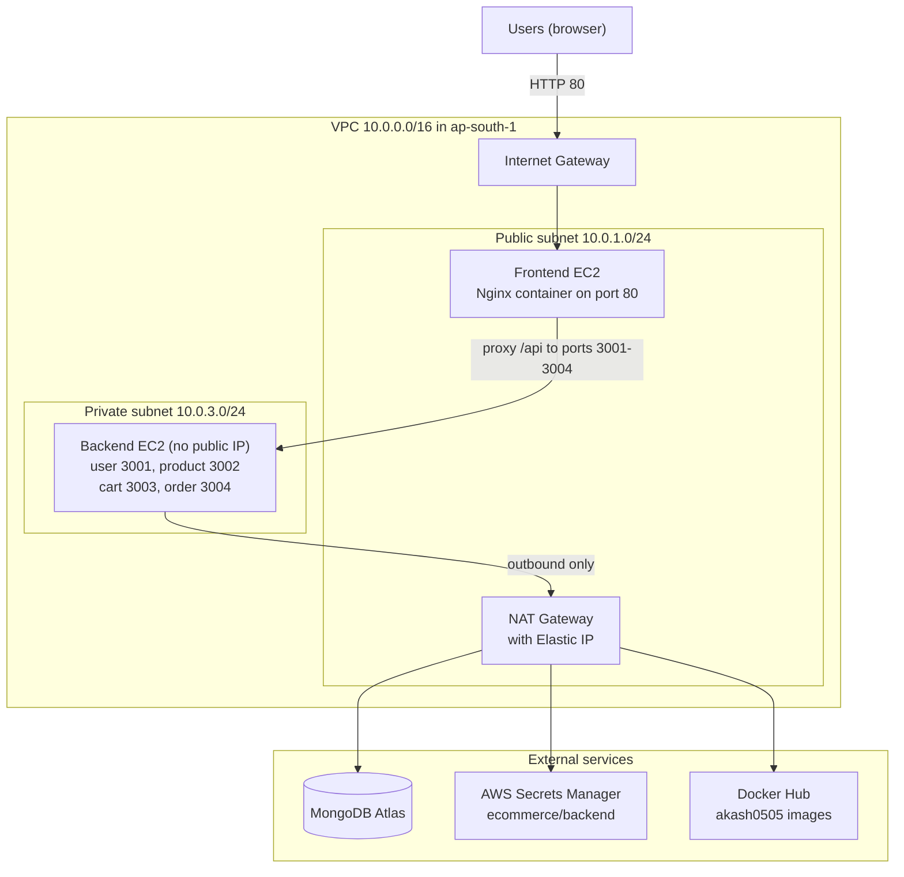
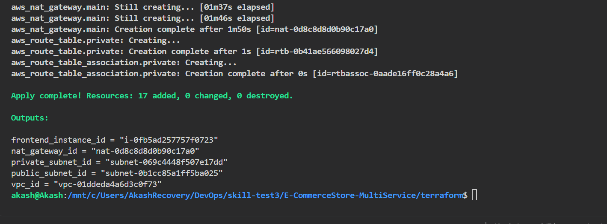
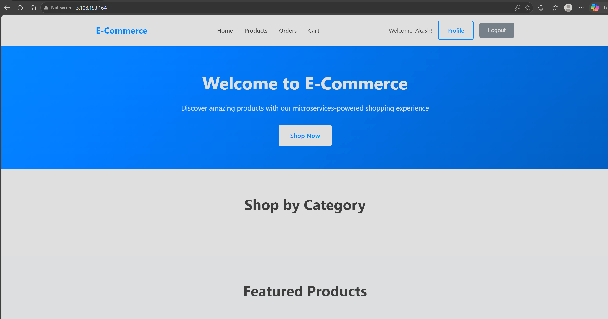

# E-Commerce Microservices on AWS

Terraform and Docker deployment of a Node.js and React e-commerce application in the AWS Mumbai region (`ap-south-1`).

## Overview

This project deploys an e-commerce application, built as four Node.js (Express) microservices and one React frontend, to AWS. Every service runs as a Docker container from an image hosted on Docker Hub. Terraform provisions the network, security groups, IAM permissions and two EC2 instances. EC2 user-data scripts install Docker, retrieve secrets from AWS Secrets Manager, pull the images and start the containers. MongoDB Atlas is used as an external database.

The application source code is forked from [AtharvaAI/E-CommerceStore](https://github.com/AtharvaAI/E-CommerceStore) (MIT License). The Dockerfiles, Nginx configuration, Terraform configuration and documentation were added for this deployment.

## Goals and Scope

Goals:

- Containerize the four backend services and the frontend, and publish the images to Docker Hub.
- Provision a VPC with a public and a private subnet, an Internet Gateway, a NAT Gateway, security groups, an IAM role and two EC2 instances with Terraform.
- Expose only the frontend to the internet and keep the backend services in a private subnet.
- Keep the database connection string and the JWT secret out of the repository by reading them from AWS Secrets Manager.
- Make the infrastructure reproducible with `terraform apply`.

Out of scope (not present in this repository):

- HTTPS or TLS termination, a load balancer and autoscaling.
- Multi-AZ or multi-instance redundancy. Both subnets are in `ap-south-1a`.
- CI/CD pipelines, monitoring and alerting.
- Provisioning of MongoDB Atlas and seed data for the product catalog.

## Key Features

The following features are implemented in the source code. Only part of them has been verified on AWS; see [Verification Summary](#verification-summary).

- User registration and login with JWT authentication (24-hour token expiry), password hashing and profile retrieval and update.
- Product catalog with pagination, category filter, price range, text search, sorting and a featured flag; category management; a stock-update endpoint.
- Per-user shopping cart: add, update, remove, clear and validate items against the product service.
- Order creation from the cart, order history, order status updates and cancellation.
- Simulated payment processing and refunds (the payment step is simulated in the code, there is no payment gateway).
- React single-page application with pages for Home, Products, Product Detail, Cart, Checkout, Orders, Profile, Login and Register.

## Technology Stack

| Layer | Technology |
| --- | --- |
| Frontend | React 18, React Router 6, Axios, React Query, built with `react-scripts` 5.0.1 |
| Web server | Nginx (`nginx:alpine`) serving the React build and acting as a reverse proxy |
| Backend | Node.js 22 (container base image `node:22-alpine`), Express 4, Mongoose 7, JSON Web Tokens, bcryptjs |
| Database | MongoDB Atlas (external, one database per service) |
| Containers | Docker, images hosted on Docker Hub under `akash0505` |
| Infrastructure as code | Terraform 1.5.0 or later, AWS provider `~> 6.0` (lock file pins 6.69.1) |
| AWS services | VPC, EC2, Internet Gateway, NAT Gateway, Elastic IP, IAM, Secrets Manager |
| EC2 operating system | Amazon Linux 2 (most recent `amzn2-ami-hvm-*-x86_64-gp2` image) |

## Architecture

Users reach the frontend EC2 instance over HTTP on port 80. The Nginx container on that instance serves the React application and forwards every `/api/...` request to the backend EC2 instance by its private IP address. The backend instance runs four service containers on ports 3001 to 3004, has no public IP address and accepts traffic only from the frontend security group. Outbound traffic from the private subnet (Docker Hub, Secrets Manager and MongoDB Atlas) goes through the NAT Gateway.

A detailed description, the request flow and the security group rules are in [docs/architecture.md](docs/architecture.md).

## Repository Structure

| Path | Description |
| --- | --- |
| `backend/user-service/` | User service (port 3001): registration, login, profile. Contains its `Dockerfile`. |
| `backend/product-service/` | Product service (port 3002): products and categories. Contains its `Dockerfile`. |
| `backend/cart-service/` | Cart service (port 3003): shopping cart. Contains its `Dockerfile`. |
| `backend/order-service/` | Order service (port 3004): orders and simulated payments. Contains its `Dockerfile`. |
| `frontend/` | React application source. |
| `frontend/Dockerfile` | Two-stage build: React build, then Nginx. |
| `frontend/default.conf.template` | Nginx configuration template; `${BACKEND_PRIVATE_IP}` is filled in when the container starts. |
| `terraform/providers.tf` | Terraform version and AWS provider configuration. |
| `terraform/variables.tf` | Input variables (region, project name, instance type, Docker Hub user, key pair). |
| `terraform/main.tf` | VPC, subnets, gateways, route tables, security groups, IAM, EC2 instances and user-data. |
| `terraform/outputs.tf` | Output values, including the frontend public IP and DNS name. |
| `terraform/.terraform.lock.hcl` | Locked provider versions. |
| `docs/` | Detailed documentation (see [Documentation Index](#documentation-index)). |
| `docs/screenshots/` | Screenshots referenced by the documentation. |

## AWS Resource Summary

All resources are in `ap-south-1`. Names use the `project_name` variable (default `ecommerce`). A fresh `terraform apply` creates 17 resources and reads two data sources.

| Resource | Name | Purpose |
| --- | --- | --- |
| VPC | `ecommerce-vpc` (`10.0.0.0/16`) | Isolated network |
| Public subnet | `ecommerce-public-subnet` (`10.0.1.0/24`, `ap-south-1a`) | Frontend instance and NAT Gateway; public IPs assigned on launch |
| Private subnet | `ecommerce-private-subnet` (`10.0.3.0/24`, `ap-south-1a`) | Backend instance; no public IPs |
| Internet Gateway | `ecommerce-igw` | Internet connectivity for the public subnet |
| Elastic IP and NAT Gateway | `ecommerce-nat-eip`, `ecommerce-nat-gateway` | Outbound-only internet access for the private subnet |
| Route tables | `ecommerce-public-rt`, `ecommerce-private-rt` | Default route to the Internet Gateway (public) and to the NAT Gateway (private) |
| Security groups | `ecommerce-frontend-sg`, `ecommerce-backend-sg` | TCP 80 from the internet to the frontend; TCP 3001 to 3004 from the frontend group to the backend |
| EC2 instance | `ecommerce-frontend-instance` | Runs the frontend container |
| EC2 instance | `ecommerce-backend` | Runs the four backend containers |
| IAM role, policy and instance profile | `ecommerce-backend-role`, `ecommerce-read-backend-secret`, `ecommerce-backend-profile` | Lets the backend instance read the `ecommerce/backend` secret |
| Secrets Manager secret (data source) | `ecommerce/backend` | Created manually; holds the MongoDB base URI and the JWT secret |
| AMI (data source) | Amazon Linux 2 | Image for both instances |

> **Screenshot placeholder (not yet captured): EC2 instances.**
> What it demonstrates: the public frontend instance and the private backend instance running in `ap-south-1`.
> Capture the EC2 instance list showing `ecommerce-frontend-instance` and `ecommerce-backend` in the Running state. Save it as `docs/screenshots/ec2-instances.png`, then uncomment the image line below.
>
> <!--  -->

## Docker Image Inventory

| Image | Source folder | Port | Base image |
| --- | --- | --- | --- |
| `akash0505/ecommerce-frontend:latest` | `frontend/` | 80 | `node:22-alpine` (build), `nginx:alpine` (runtime) |
| `akash0505/ecommerce-user-service:latest` | `backend/user-service/` | 3001 | `node:22-alpine` |
| `akash0505/ecommerce-product-service:latest` | `backend/product-service/` | 3002 | `node:22-alpine` |
| `akash0505/ecommerce-cart-service:latest` | `backend/cart-service/` | 3003 | `node:22-alpine` |
| `akash0505/ecommerce-order-service:latest` | `backend/order-service/` | 3004 | `node:22-alpine` |

The EC2 instances pull these images without logging in, so the Docker Hub repositories must be public.

## Prerequisites

- An AWS account, credentials configured locally, and access to `ap-south-1`.
- An existing EC2 key pair in `ap-south-1` (the Terraform default name is `devops`).
- Terraform 1.5.0 or later.
- Docker and a Docker Hub account.
- A MongoDB Atlas cluster, a database user and a connection string.
- A Secrets Manager secret named `ecommerce/backend` containing the keys `MONGODB_BASE_URI` and `JWT_SECRET`.

## Quick Deployment Overview

The full procedure, with every command and its explanation, is in [docs/deployment-guide.md](docs/deployment-guide.md).

1. Build the five Docker images and push them to Docker Hub.
2. Create the MongoDB Atlas cluster and the `ecommerce/backend` secret in Secrets Manager.
3. In the `terraform` directory, run `terraform init`, `terraform validate` and `terraform plan`, and review the plan.
4. Allow the NAT Gateway's Elastic IP in the MongoDB Atlas network access list. The deployment guide shows how to create that Elastic IP first with a targeted apply, so the address can be allowed before the backend instance boots.
5. Run `terraform apply` and confirm. A new deployment adds 17 resources.
6. Read the application address with `terraform output frontend_public_ip` and open it in a browser.
7. Validate the deployment with [docs/testing-and-validation.md](docs/testing-and-validation.md).

> **Screenshot placeholder (not yet captured): Terraform apply and outputs.**
> What it demonstrates: a successful `terraform apply` and the output values, including `frontend_public_ip`.
> Capture the end of the `terraform apply` output. Save it as `docs/screenshots/terraform-apply-outputs.png`, then uncomment the image line below.
>
> <!--  -->

## Accessing the Application

- URL: `http://<frontend-public-ip>` (HTTP on port 80; there is no HTTPS).
- Get the address with `terraform output frontend_public_ip` or `terraform output frontend_public_dns`.
- The frontend instance uses an automatically assigned public IP, not an Elastic IP. The address can change if the instance is stopped and started or replaced, so do not treat it as permanent.

> **Screenshot placeholder (not yet captured): Application homepage.**
> What it demonstrates: the React application served by the frontend instance over its public address.
> Capture the homepage with the address bar visible. Save it as `docs/screenshots/app-homepage.png`, then uncomment the image line below.
>
> <!--  -->

## Verification Summary

Results below were observed on the deployed environment and reported by the project author. Details, commands and the full table are in [docs/testing-and-validation.md](docs/testing-and-validation.md).

| Area | Result | Status |
| --- | --- | --- |
| Terraform apply | Infrastructure applied successfully | PASS |
| Frontend access | Website reachable on the frontend public IPv4 address | PASS |
| User registration and login | Registration followed by login worked in the browser | PASS |
| Backend reachability | From the frontend instance, ports 3001 to 3004 returned Express HTTP responses | PASS |
| Product API through Nginx | `GET /api/products` returned 200 after a redirect to `/api/products/`; the catalog is empty | PASS |
| Product catalog with data | The new Atlas database has no products | NOT VERIFIED |
| Cart, order creation, checkout, payment | Not tested | NOT VERIFIED |
| End-to-end purchase flow | Not tested | NOT VERIFIED |

## Known Limitations

- Cart operations, order creation, checkout and payment have not been verified on AWS.
- A configuration review identified three items that may affect the order flow: the order container is not given `CART_SERVICE_URL`, the Nginx location `/api/orders/` redirects `POST /api/orders`, and `JWT_SECRET` is passed with `-e JWT_SECRET` from a shell variable that is not exported. These were identified by reading the configuration and have not been tested on AWS. See the "Known limitations" section of [docs/testing-and-validation.md](docs/testing-and-validation.md).
- The product catalog is empty and the repository contains no seed script.
- The deployment uses HTTP only, a single Availability Zone, one instance per tier and mutable `latest` image tags.

## Security Considerations

- Only TCP 80 on the frontend instance is open to the internet. The backend instance has no public IP address and its security group accepts ports 3001 to 3004 only from the frontend security group.
- The backend IAM role can read one secret (`ecommerce/backend`) and nothing else.
- Secret values are never stored in the repository or in Terraform variables. Never commit `.pem` files, `terraform.tfstate`, `.tfvars` files, AWS keys, MongoDB credentials or JWT secrets. The `.gitignore` covers state files, `.tfvars` and `.env` files, but it does not currently list `*.pem`, so keep key files outside the repository.
- The Terraform configuration does not open TCP 22. SSH access to the frontend instance requires a temporary rule limited to your own IP address (see the deployment guide).
- Within the application, only the user service checks JWTs. Details and other observations are in [docs/architecture.md](docs/architecture.md#9-trust-boundaries-and-security-considerations).

## Cleanup

1. From the `terraform` directory run `terraform destroy` and confirm.
2. NAT Gateways, Elastic IPs and EC2 instances incur charges while they exist, so destroy the stack when you are finished.
3. Resources created outside Terraform are not removed: the `ecommerce/backend` secret, the MongoDB Atlas cluster and its access-list entry, the EC2 key pair and the Docker Hub images. Remove them separately if they are no longer needed.

## Documentation Index

| Document | Contents |
| --- | --- |
| [docs/architecture.md](docs/architecture.md) | Components, network design, request flow, Nginx routing, security groups, IAM, Secrets Manager, MongoDB Atlas, trust boundaries and glossary |
| [docs/deployment-guide.md](docs/deployment-guide.md) | Step-by-step build, push, configuration, Terraform deployment, access, update and destroy procedures |
| [docs/testing-and-validation.md](docs/testing-and-validation.md) | Test procedures, results table and known limitations |
| [docs/troubleshooting.md](docs/troubleshooting.md) | Diagnostics, common failures and the frontend container incident case study |

## Submission Checklist

- [ ] `terraform validate` and `terraform plan` pass, and `terraform apply` completes.
- [ ] The five images exist on Docker Hub as public repositories.
- [ ] The application opens on `http://<frontend-public-ip>`.
- [ ] No secrets, `.pem` files or state files are committed.
- [ ] Screenshots are saved in `docs/screenshots/` and every placeholder in the documentation is replaced by its image.
- [ ] The testing table in `docs/testing-and-validation.md` matches what was actually run.
- [ ] Cart, order and payment tests are either completed and recorded or left marked NOT VERIFIED.

Screenshots expected in `docs/screenshots/`:

| File | Used in |
| --- | --- |
| `ec2-instances.png` | README, architecture |
| `terraform-apply-outputs.png` | README, deployment guide |
| `app-homepage.png` | README |
| `vpc-resource-map.png` | architecture |
| `route-tables.png` | architecture |
| `gateways.png` | architecture |
| `security-group-frontend.png` | architecture |
| `security-group-backend.png` | architecture |
| `secrets-manager-metadata.png` | architecture, deployment guide |
| `dockerhub-repositories.png` | deployment guide |
| `terraform-validate.png` | deployment guide |
| `terraform-plan.png` | deployment guide |
| `ec2-status-checks.png` | testing |
| `frontend-docker-ps.png` | testing |
| `backend-reachability.png` | testing |
| `api-products-proxy.png` | testing |
| `browser-network-tab.png` | testing |
| `registration-success.png` | testing |
| `login-success.png` | testing |
| `cloud-init-malformed-docker-run.png` | troubleshooting |

## Author and License

- Author: Akash Agarwal ([akashagarwal99-oss](https://github.com/akashagarwal99-oss)).
- License: MIT, see [LICENSE](LICENSE).
- Application source: [AtharvaAI/E-CommerceStore](https://github.com/AtharvaAI/E-CommerceStore).
