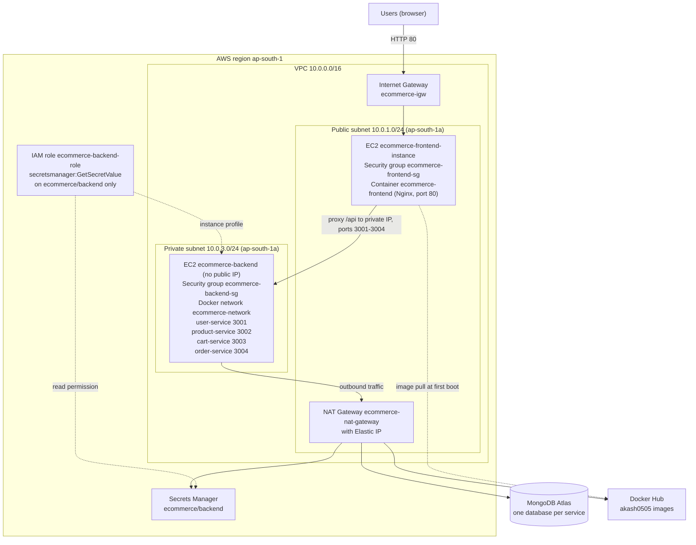
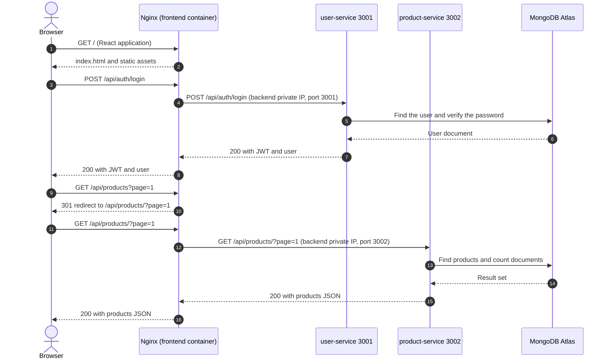
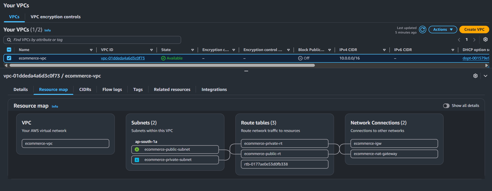
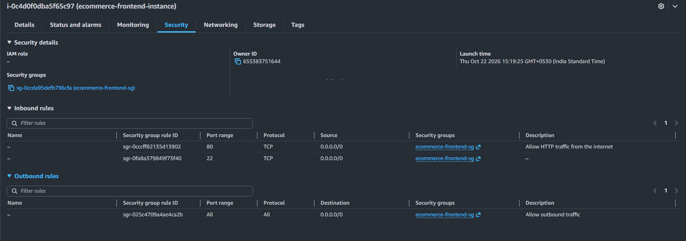
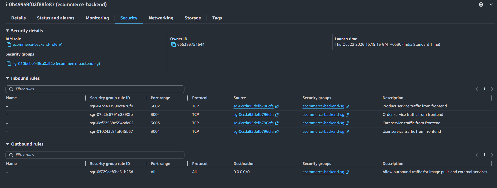

# Architecture

This document describes how the e-commerce application is structured and how it is deployed on AWS. All statements are based on the repository files (`terraform/`, `frontend/`, `backend/`). Results that were observed on the deployed environment are listed in [testing-and-validation.md](testing-and-validation.md).

Related documents: [README](../README.md), [deployment guide](deployment-guide.md), [troubleshooting](troubleshooting.md).

## Contents

1. [Overview](#1-overview)
2. [Components and Responsibilities](#2-components-and-responsibilities)
3. [Architecture Diagram](#3-architecture-diagram)
4. [Request Flow](#4-request-flow)
5. [Nginx Reverse-Proxy Behavior](#5-nginx-reverse-proxy-behavior)
6. [Backend Services](#6-backend-services)
7. [Network Architecture](#7-network-architecture)
8. [Security Groups, IAM, Secrets Manager and MongoDB Atlas](#8-security-groups-iam-secrets-manager-and-mongodb-atlas)
9. [Trust Boundaries and Security Considerations](#9-trust-boundaries-and-security-considerations)
10. [Glossary](#10-glossary)

## 1. Overview

The application is split into one frontend and four backend microservices. Two EC2 instances host them:

- The frontend instance sits in a public subnet and runs one container (Nginx serving the React build).
- The backend instance sits in a private subnet and runs four containers (user, product, cart and order services) on a user-defined Docker network.

The services store data in MongoDB Atlas, which is outside AWS and outside this repository. Secrets are kept in AWS Secrets Manager and are read by the backend instance when it boots.

## 2. Components and Responsibilities

| Component | Responsibility | Runs on |
| --- | --- | --- |
| React frontend | Browser user interface. Sends API calls to `/api/...` and keeps the JWT in the browser's `localStorage`. | User's browser, served from the frontend instance |
| Nginx | Serves the React build, forwards `/api/...` requests to the backend instance and falls back to `index.html` for page routes. | Frontend instance, container `ecommerce-frontend`, port 80 |
| User service | Registration, login, JWT issuing, profile retrieval and update. | Backend instance, container `user-service`, port 3001 |
| Product service | Product catalog and categories, including a stock-update endpoint. | Backend instance, container `product-service`, port 3002 |
| Cart service | Per-user shopping cart; validates cart items against the product service. | Backend instance, container `cart-service`, port 3003 |
| Order service | Order creation, status and cancellation, and simulated payments. | Backend instance, container `order-service`, port 3004 |
| MongoDB Atlas | Persistent storage with one database per service. | External managed service |
| AWS Secrets Manager | Stores the MongoDB base connection string and the JWT secret in the secret `ecommerce/backend`. | AWS |
| Docker Hub | Hosts the five images under the `akash0505` account. | External registry |
| Terraform | Creates the AWS network, security groups, IAM resources and EC2 instances. | Operator's machine |

The frontend reaches the backend through Nginx because the browser can only reach the public subnet. When the frontend image is built with the four `REACT_APP_*_SERVICE_URL` build arguments set to `/`, the browser sends API calls to the same address it loaded the page from, and Nginx forwards them (see the deployment guide). If these values are empty, `frontend/src/services/api.js` falls back to `http://localhost:300x` addresses, which do not work from a remote browser.

## 3. Architecture Diagram

## 4. Request Flow

The sequence below shows two representative requests: a login, and a product list request that is redirected once by Nginx.

Step by step:

1. The browser loads the React application from Nginx on the frontend instance.
2. The application sends API requests to its own address under `/api/...`.
3. Nginx matches the path against the locations in `frontend/default.conf.template` and proxies the request to `<backend-private-ip>:<service-port>`.
4. The backend security group accepts the request because its source is the frontend security group.
5. The service queries its own MongoDB Atlas database. The connection leaves the private subnet through the NAT Gateway.
6. The response travels back through Nginx to the browser.

The redirect in the second request is described in section 5. The author observed this behavior for `GET /api/products`.

## 5. Nginx Reverse-Proxy Behavior

`frontend/default.conf.template` is copied into the image as `/etc/nginx/templates/default.conf.template`. When the container starts, the official Nginx image replaces `${BACKEND_PRIVATE_IP}` with the environment variable of the same name and writes `/etc/nginx/conf.d/default.conf`. The Terraform user-data script supplies the backend instance's private IP address through `docker run -e BACKEND_PRIVATE_IP=...`.

Locations in the current configuration (the server listens on port 80 with `server_name _`):

| Location | Forwarded to | Service |
| --- | --- | --- |
| `/api/auth/` | `http://<backend-private-ip>:3001/api/auth/` | User service |
| `/api/users/` | `http://<backend-private-ip>:3001/api/users/` | User service |
| `/api/products/` | `http://<backend-private-ip>:3002/api/products/` | Product service |
| `/api/categories` | `http://<backend-private-ip>:3002/api/categories` | Product service |
| `/api/cart/` | `http://<backend-private-ip>:3003/api/cart/` | Cart service |
| `/api/orders/` | `http://<backend-private-ip>:3004/api/orders/` | Order service |
| `/api/payments/` | `http://<backend-private-ip>:3004/api/payments/` | Order service |
| `/` | `try_files $uri $uri/ /index.html` | Static React build and single-page-app fallback |

Behavior to be aware of:

- **Trailing-slash redirect.** For a location that ends in `/` and uses `proxy_pass`, Nginx answers a request for the same path without the slash with a permanent redirect (301) to the path with the slash. A request such as `GET /api/products` therefore returns `301` with `Location: .../api/products/`, and the follow-up request is proxied. The location `/api/categories` has no trailing slash, so it matches both `/api/categories` and `/api/categories/` without a redirect.
- **Paths are not rewritten.** Each `proxy_pass` keeps the same path prefix, so `/api/cart/<userId>` reaches the cart service as `/api/cart/<userId>`.
- **No custom proxy settings.** The file contains no `proxy_set_header`, timeout or buffering directives; Nginx defaults apply.
- **`/health` is not proxied.** The backend `/health` endpoints exist on the backend instance only. A request for `/health` on the frontend address falls through to `location /` and returns the React `index.html`, so it must not be used as a health check.
- **No TLS.** The server block listens on port 80 only.

## 6. Backend Services

All four services are Express applications started with `npm start`, which runs `node server.js`. Each one connects to MongoDB through the `MONGODB_URI` environment variable, listens on the port from `PORT` (default shown below) and exposes `GET /health`, which returns JSON with the service name, `"status":"OK"` and the port.

| Service | Port | Database | Routes (from the route files) |
| --- | --- | --- | --- |
| User | 3001 | `ecommerce_users` | `POST /api/auth/register`, `POST /api/auth/login`, `GET /api/auth/me` (JWT required), `GET /api/users/profile` (JWT required), `PUT /api/users/profile` (JWT required), `GET /api/users/:id` |
| Product | 3002 | `ecommerce_products` | `GET /api/products`, `GET /api/products/:id`, `POST /api/products`, `PUT /api/products/:id`, `DELETE /api/products/:id`, `POST /api/products/:id/stock`, `GET /api/categories`, `GET /api/categories/:id`, `POST /api/categories`, `PUT /api/categories/:id`, `DELETE /api/categories/:id` |
| Cart | 3003 | `ecommerce_carts` | `GET /api/cart/:userId`, `POST /api/cart/:userId/items`, `PUT /api/cart/:userId/items/:productId`, `DELETE /api/cart/:userId/items/:productId`, `DELETE /api/cart/:userId`, `POST /api/cart/:userId/validate` |
| Order | 3004 | `ecommerce_orders` | `GET /api/orders/user/:userId`, `GET /api/orders/:id`, `POST /api/orders`, `PUT /api/orders/:id/status`, `DELETE /api/orders/:id`, `POST /api/payments/process`, `POST /api/payments/refund`, `GET /api/payments/order/:orderId` |

Service-to-service calls and the environment variables the code reads:

| Service | Calls | Environment variables read by the code | Set by the user-data script |
| --- | --- | --- | --- |
| User | None | `MONGODB_URI`, `JWT_SECRET` (falls back to a built-in default if unset), `PORT` | `MONGODB_URI`, `JWT_SECRET` (passed with `-e JWT_SECRET`) |
| Product | None | `MONGODB_URI`, `PORT` | `MONGODB_URI` |
| Cart | Product service | `MONGODB_URI`, `PRODUCT_SERVICE_URL`, `PORT` | `MONGODB_URI`, `PRODUCT_SERVICE_URL=http://product-service:3002` |
| Order | Cart service, product service | `MONGODB_URI`, `CART_SERVICE_URL`, `PRODUCT_SERVICE_URL`, `USER_SERVICE_URL` (declared but not used), `PORT` | `MONGODB_URI`, `PRODUCT_SERVICE_URL=http://product-service:3002` |

The cart and order containers reach the product service by container name because all four containers join the Docker network `ecommerce-network`. `CART_SERVICE_URL` is read by the order service but is not set by the user-data script, and the `-e JWT_SECRET` form depends on the variable being exported in the script. Both points are discussed in [testing-and-validation.md](testing-and-validation.md#known-limitations).

Each container is started with `--restart unless-stopped` and publishes its port on the backend instance (`-p 3001:3001` and so on). The Dockerfiles do not define a `HEALTHCHECK`.

## 7. Network Architecture

### 7.1 VPC and subnets

| Resource | Name | CIDR | Details |
| --- | --- | --- | --- |
| VPC | `ecommerce-vpc` | `10.0.0.0/16` | DNS support and DNS hostnames enabled |
| Public subnet | `ecommerce-public-subnet` | `10.0.1.0/24` | `ap-south-1a`; instances launched here receive a public IP automatically |
| Private subnet | `ecommerce-private-subnet` | `10.0.3.0/24` | `ap-south-1a`; no automatic public IP |

Both subnets are in the same Availability Zone, so the deployment has no zone-level redundancy.

### 7.2 Internet Gateway and NAT Gateway

- **Internet Gateway (`ecommerce-igw`)** attaches the VPC to the internet. It carries inbound requests from users to the frontend instance and outbound traffic from the public subnet (for example the frontend instance pulling its image from Docker Hub).
- **NAT Gateway (`ecommerce-nat-gateway`)** is placed in the public subnet and uses the Elastic IP `ecommerce-nat-eip`. It lets the backend instance, which has no public IP, start outbound connections to Docker Hub, AWS Secrets Manager and MongoDB Atlas. It does not accept connections started from the internet.
- The Elastic IP of the NAT Gateway is the public address that MongoDB Atlas sees for backend traffic. It must be added to the Atlas network access list (see section 8.3).

### 7.3 Route tables

| Route table | Associated subnet | Routes |
| --- | --- | --- |
| `ecommerce-public-rt` | Public subnet | `10.0.0.0/16` local (implicit), `0.0.0.0/0` to `ecommerce-igw` |
| `ecommerce-private-rt` | Private subnet | `10.0.0.0/16` local (implicit), `0.0.0.0/0` to `ecommerce-nat-gateway` |

>

>

>

### 7.4 Public and private components

The table describes the Terraform configuration. Rules added manually in the AWS console are not visible here, so confirm the live security groups before relying on this table.

| Component | Location | Reachable from the internet? | Basis in the configuration |
| --- | --- | --- | --- |
| Frontend instance and Nginx container | Public subnet, public IP | Yes, on TCP 80 only | The public subnet routes to the Internet Gateway; `ecommerce-frontend-sg` allows TCP 80 from `0.0.0.0/0` and has no other inbound rule |
| NAT Gateway | Public subnet | No inbound connections | A NAT Gateway only handles connections started from inside the VPC |
| Backend instance and four service containers | Private subnet | No, not directly | No public IP (`associate_public_ip_address = false`); the private route table has no route to the Internet Gateway; `ecommerce-backend-sg` allows TCP 3001 to 3004 only from the frontend security group |
| MongoDB Atlas | External | Public endpoint, protected by Atlas credentials and access list | No VPC peering or private endpoint is defined in Terraform |
| AWS Secrets Manager | AWS service endpoint | Public AWS endpoint, protected by IAM | No VPC endpoint is defined, so the backend reaches it through the NAT Gateway |
| Docker Hub | External | Public registry | Public repositories are pulled without credentials |

## 8. Security Groups, IAM, Secrets Manager and MongoDB Atlas

### 8.1 Security groups

| Security group | Direction | Protocol and port | Source or destination | Purpose |
| --- | --- | --- | --- | --- |
| `ecommerce-frontend-sg` | Inbound | TCP 80 | `0.0.0.0/0` | Public HTTP access to Nginx |
| `ecommerce-frontend-sg` | Outbound | All | `0.0.0.0/0` | Image pull and traffic to the backend |
| `ecommerce-backend-sg` | Inbound | TCP 3001 | `ecommerce-frontend-sg` | User service |
| `ecommerce-backend-sg` | Inbound | TCP 3002 | `ecommerce-frontend-sg` | Product service |
| `ecommerce-backend-sg` | Inbound | TCP 3003 | `ecommerce-frontend-sg` | Cart service |
| `ecommerce-backend-sg` | Inbound | TCP 3004 | `ecommerce-frontend-sg` | Order service |
| `ecommerce-backend-sg` | Outbound | All | `0.0.0.0/0` | Image pull, Secrets Manager and MongoDB Atlas through the NAT Gateway |

The configuration defines no inbound rule for TCP 22 on either group, and no rule that lets the frontend group reach the backend on TCP 22. SSH therefore needs a rule that is added outside Terraform (see the [deployment guide](deployment-guide.md#15-ssh-into-the-frontend-instance)), and the backend instance cannot be reached over SSH with the current rules.

>

>

### 8.2 IAM role and Secrets Manager

The secret `ecommerce/backend` is created manually before Terraform runs. Terraform looks it up with a `data` source, which reads the secret's metadata (name and ARN) and not its value. The user-data script expects the secret value to be JSON with two keys: `MONGODB_BASE_URI` and `JWT_SECRET`.

How the integration works:

1. `ecommerce-backend-role` can be assumed by the EC2 service (`ec2.amazonaws.com`).
2. The inline policy `ecommerce-read-backend-secret` allows only `secretsmanager:GetSecretValue` on the ARN of `ecommerce/backend`.
3. `ecommerce-backend-profile` attaches the role to the backend instance. The frontend instance has no IAM role.
4. At first boot, the backend user-data script installs `awscli` and `jq` and runs `aws secretsmanager get-secret-value --secret-id ecommerce/backend --region ap-south-1 --query SecretString --output text`. The AWS CLI uses the instance role for credentials.
5. The script extracts the two keys with `jq -er`, which fails if a key is missing, and builds one connection string per service by appending the database name to `MONGODB_BASE_URI` (`ecommerce_users`, `ecommerce_products`, `ecommerce_carts`, `ecommerce_orders`). For that reason the base URI must end with `/`.
6. The values are passed to the containers as environment variables, and the script unsets its shell variables at the end.

The script runs with `set -eu`, so a failed secret lookup stops the script before any service container is started.

>

### 8.3 MongoDB Atlas

- MongoDB Atlas is an external managed database. Terraform does not create it, and the repository holds no connection details.
- Each service uses its own database (`ecommerce_users`, `ecommerce_products`, `ecommerce_carts`, `ecommerce_orders`) on the same cluster, selected by the database name appended to the base URI. Databases and collections appear in Atlas after the first write.
- Backend traffic reaches Atlas through the NAT Gateway, so Atlas sees the NAT Gateway's Elastic IP as the client address. That address (or a wider range) must be in the Atlas network access list. The address is not a Terraform output; the deployment guide shows how to look it up.
- Atlas requires TLS for client connections and authenticates with the database user stored in the connection string inside the secret.
- Evidence from the deployed environment: registration and login succeeded, which requires the user service to write to and read from Atlas using the connection string from the secret. The product endpoint returned a valid empty result; the code builds that response only after its two database queries (`find` and `countDocuments`) complete, which indicates that the product service also reached the database.

## 9. Trust Boundaries and Security Considerations

### 9.1 Trust boundaries

| Boundary | What crosses it | Controls in this repository | Observations |
| --- | --- | --- | --- |
| Internet to frontend instance | HTTP requests on port 80 | Security group allows only TCP 80 | Traffic is unencrypted HTTP; there is no TLS, WAF or rate limiting |
| Frontend to backend | HTTP requests to the backend private IP on ports 3001 to 3004 | Private subnet; security group source is the frontend group | Traffic inside the VPC is unencrypted; all four ports are open to the frontend instance |
| Backend to the internet | Outbound connections through the NAT Gateway | NAT Gateway accepts no inbound connections | Egress is unrestricted (all protocols and ports to `0.0.0.0/0`) |
| Backend to Secrets Manager | `GetSecretValue` call | IAM role limited to one action on one secret | The secret is read once at first boot |
| Backend to MongoDB Atlas | Database traffic | Atlas credentials and access list (configured outside this repository) | Atlas requires TLS |
| Operator to AWS | Terraform runs with the operator's AWS credentials | `.gitignore` excludes `*.tfstate`, `.terraform/`, `*.tfvars` and `.env` files | State is stored locally because no remote backend is configured |
| Operator to instances | SSH (not configured by Terraform) | No inbound rule for TCP 22 | A temporary rule restricted to the operator's IP is required |

### 9.2 Observations

- **Authentication is enforced only in the user service.** The JWT middleware is used on `GET /api/auth/me` and on the profile routes. The product, cart and order services contain no authentication middleware. Route comments such as "Admin" or "Private" are not enforced. Because Nginx proxies these paths, product and category write endpoints and cart and order endpoints that take a `userId` are reachable from the internet through the frontend address.
- **JWT secret fallback.** The user service signs and verifies tokens with `JWT_SECRET` and falls back to a built-in default string if the variable is not set. The user-data script passes the secret with `-e JWT_SECRET`; see [known limitations](testing-and-validation.md#known-limitations).
- **Token storage.** The frontend stores the JWT in the browser's `localStorage`.
- **HTTP only.** Credentials and tokens are sent unencrypted between the browser and the frontend instance.
- **Single instance per tier and one Availability Zone.** Failure of either instance interrupts the application.
- **Mutable image tags.** Instances pull `:latest` at first boot, so a rebuilt image changes what a replacement instance runs.
- **Unstable public address.** The frontend public IP is not an Elastic IP and can change.
- **Least-privilege IAM.** The backend role is limited to reading one secret. The frontend instance has no role.
- **Secrets are not in the repository.** The secret values live only in Secrets Manager and in the running containers' environment.
- **Key files.** The EC2 key pair is referenced by name (`key_pair_name`, default `devops`). The `.pem` private key must stay outside the repository. The current `.gitignore` does not contain `*.pem`, so adding it is recommended.

## 10. Glossary

| Term | Meaning in this project |
| --- | --- |
| VPC (Virtual Private Cloud) | A logically isolated network in AWS. Here `ecommerce-vpc` with CIDR `10.0.0.0/16`. |
| Subnet | A range of IP addresses inside a VPC, tied to one Availability Zone. Here a public subnet for the frontend and a private subnet for the backend. |
| Internet Gateway | A VPC component that connects the VPC to the internet in both directions. It serves the public subnet. |
| NAT Gateway | A managed service that lets instances without public IPs start outbound internet connections but blocks connections started from the internet. It serves the private subnet. |
| EC2 | Amazon Elastic Compute Cloud, the virtual machine service. Two instances host the containers. |
| Security group | A stateful virtual firewall attached to an instance. Rules can name another security group as the source, as the backend group does. |
| IAM | AWS Identity and Access Management. Here a role and policy that let the backend instance read one secret. |
| Secrets Manager | An AWS service that stores secrets and controls access with IAM. Here the secret `ecommerce/backend`. |
| Docker | A container platform. Each service runs as a container started from an image. |
| Nginx | A web server and reverse proxy. Here it serves the React build and forwards `/api/...` requests to the backend. |
| Terraform | An infrastructure-as-code tool that creates AWS resources from the files in `terraform/`. |
| MongoDB Atlas | MongoDB's managed cloud database service. Here the external database for all four services. |
| Elastic IP | A static public IPv4 address. Here the address of the NAT Gateway. |
| User-data | A script that EC2 runs through cloud-init at the first boot of an instance. Here it installs Docker and starts the containers. |
| Reverse proxy | A server that forwards client requests to other servers. Nginx plays this role for the API. |
