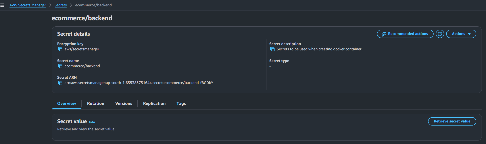

# Deployment Guide

This guide explains how to build the Docker images, configure the external services and deploy the application to AWS (`ap-south-1`) with Terraform. Every command matches the files in this repository. Replace each `<placeholder>` with your own value and never commit real credentials.

Related documents: [README](../README.md), [architecture](architecture.md), [testing and validation](testing-and-validation.md), [troubleshooting](troubleshooting.md).

## Contents

1. [Local Development Prerequisites](#1-local-development-prerequisites)
2. [Repository Structure and Source Preparation](#2-repository-structure-and-source-preparation)
3. [Building the Docker Images](#3-building-the-docker-images)
4. [Docker Hub Authentication and Pushing Images](#4-docker-hub-authentication-and-pushing-images)
5. [AWS Account and Region Prerequisites](#5-aws-account-and-region-prerequisites)
6. [MongoDB Atlas Configuration and Network Access](#6-mongodb-atlas-configuration-and-network-access)
7. [Secrets Manager Configuration](#7-secrets-manager-configuration)
8. [Terraform Variables and Configuration Files](#8-terraform-variables-and-configuration-files)
9. [Terraform Workflow](#9-terraform-workflow)
10. [Reviewing the Terraform Plan](#10-reviewing-the-terraform-plan)
11. [Infrastructure Creation and Output Retrieval](#11-infrastructure-creation-and-output-retrieval)
12. [How the User-Data Scripts Work](#12-how-the-user-data-scripts-work)
13. [How the Frontend Uses the Backend Private IP](#13-how-the-frontend-uses-the-backend-private-ip)
14. [Accessing the Website](#14-accessing-the-website)
15. [SSH into the Frontend Instance](#15-ssh-into-the-frontend-instance)
16. [Validating the Deployment](#16-validating-the-deployment)
17. [Updating Images and Redeploying](#17-updating-images-and-redeploying)
18. [Destroying the Infrastructure](#18-destroying-the-infrastructure)

## Placeholders Used in This Guide

| Placeholder | Meaning |
| --- | --- |
| `<dockerhub-username>` | Your Docker Hub account. The repository default is `akash0505`. |
| `<key-pair-name>` | Name of an existing EC2 key pair in `ap-south-1`. The Terraform default is `devops`. |
| `<path-to-key.pem>` | Local path of the private key file of that key pair. |
| `<atlas-user>`, `<atlas-password>`, `<cluster-host>` | MongoDB Atlas database user, its URL-encoded password and the cluster host name. |
| `<nat-elastic-ip>` | Public IPv4 address of the NAT Gateway's Elastic IP. |
| `<frontend-public-ip>` | Public IPv4 address of the frontend instance. |
| `<backend-private-ip>` | Private IPv4 address of the backend instance. |
| `<your-ip>` | Your own public IPv4 address, used as `<your-ip>/32`. |

## 1. Local Development Prerequisites

| Tool | Requirement | Check |
| --- | --- | --- |
| Git | Any recent version | `git --version` |
| Docker | Able to build `linux/amd64` images (the instances are x86_64 `t3.micro`) | `docker version` |
| Terraform | 1.5.0 or later (`required_version` in `providers.tf`) | `terraform version` |
| AWS CLI | Version 2, used for credentials checks, the secret and lookups | `aws --version` |
| SSH client | Needed only for SSH access to the frontend instance | `ssh -V` |

Accounts: AWS, Docker Hub and MongoDB Atlas. On Windows, the commands in this guide are written for a Bash shell such as WSL.

If you build on an ARM machine (for example Apple Silicon), add `--platform linux/amd64` to every `docker build` command, otherwise the images will not run on the EC2 instances.

## 2. Repository Structure and Source Preparation

Clone the repository and change into it:

```bash
git clone https://github.com/akashagarwal99-oss/E-CommerceStore-MultiService.git
cd E-CommerceStore-MultiService
```

Relevant structure:

```text
backend/
  user-service/      Dockerfile, server.js, routes, models   (port 3001)
  product-service/   Dockerfile, server.js, routes, models   (port 3002)
  cart-service/      Dockerfile, server.js, routes, models   (port 3003)
  order-service/     Dockerfile, server.js, routes, models   (port 3004)
frontend/
  Dockerfile
  default.conf.template
  src/, public/, package.json
terraform/
  providers.tf, variables.tf, main.tf, outputs.tf, .terraform.lock.hcl
docs/
```

No `.env` file is needed. Configuration reaches the containers in three ways: build arguments (frontend), environment variables set by the user-data script (backend) and the Secrets Manager secret.

Confirm that the services start with `node` (the Dockerfiles run `npm start`):

```bash
grep '"start"' backend/*/package.json
```

Each line should show `"start": "node server.js"`.

## 3. Building the Docker Images

Run these commands from the repository root. If you use a different Docker Hub account, replace `akash0505` everywhere and pass the same name to Terraform later (section 8).

```bash
docker build -t akash0505/ecommerce-user-service:latest    ./backend/user-service
docker build -t akash0505/ecommerce-product-service:latest ./backend/product-service
docker build -t akash0505/ecommerce-cart-service:latest    ./backend/cart-service
docker build -t akash0505/ecommerce-order-service:latest   ./backend/order-service

docker build -t akash0505/ecommerce-frontend:latest \
  --build-arg REACT_APP_USER_SERVICE_URL=/ \
  --build-arg REACT_APP_PRODUCT_SERVICE_URL=/ \
  --build-arg REACT_APP_CART_SERVICE_URL=/ \
  --build-arg REACT_APP_ORDER_SERVICE_URL=/ \
  ./frontend
```

Why the frontend build arguments are set to `/`:

- Create React App compiles `REACT_APP_*` values into the JavaScript bundle at build time, so they cannot be changed when the container starts.
- `frontend/src/services/api.js` uses each value as the Axios base URL and falls back to `http://localhost:3001` to `3004` when the value is empty. A browser on another machine cannot reach those addresses.
- With `/`, requests such as `/api/auth/login` go to the same address that served the page, and Nginx forwards them to the backend.

Check the images:

```bash
docker images "akash0505/ecommerce-*"
```

Optional local smoke test of a backend image (requires a reachable MongoDB; the connection string ends with `/` and the database name is appended):

```bash
docker run --rm -d --name user-service-test -p 3001:3001 \
  -e MONGODB_URI="<mongodb-base-uri>ecommerce_users" \
  -e JWT_SECRET="<any-test-value>" \
  akash0505/ecommerce-user-service:latest

curl -i http://localhost:3001/health
docker rm -f user-service-test
```

## 4. Docker Hub Authentication and Pushing Images

```bash
docker login

docker push akash0505/ecommerce-user-service:latest
docker push akash0505/ecommerce-product-service:latest
docker push akash0505/ecommerce-cart-service:latest
docker push akash0505/ecommerce-order-service:latest
docker push akash0505/ecommerce-frontend:latest
```

The EC2 user-data scripts run `docker pull` without logging in, so every repository must be public. Check anonymous access by logging out and pulling one image:

```bash
docker logout
docker pull akash0505/ecommerce-frontend:latest
```

>

## 5. AWS Account and Region Prerequisites

1. Configure credentials and confirm the account:

   ```bash
   aws configure
   aws sts get-caller-identity
   ```

2. Use the Mumbai region. The Terraform default is `ap-south-1`, and the subnets are hard-coded to the Availability Zone `ap-south-1a`.
3. Make sure the credentials may create VPC resources, EC2 instances, an Elastic IP, a NAT Gateway and IAM roles, policies and instance profiles, and may read the secret's metadata.
4. Check that an Elastic IP is available in your account quota for the NAT Gateway.
5. Make sure an EC2 key pair exists in `ap-south-1`. Both instances use `key_name = var.key_pair_name`, and `terraform apply` fails if the key pair does not exist.

   ```bash
   aws ec2 describe-key-pairs --key-names devops --region ap-south-1
   ```

   To create a new key pair (store the file outside the repository):

   ```bash
   aws ec2 create-key-pair --key-name <key-pair-name> --region ap-south-1 \
     --query KeyMaterial --output text > ~/.ssh/<key-pair-name>.pem
   chmod 400 ~/.ssh/<key-pair-name>.pem
   ```

## 6. MongoDB Atlas Configuration and Network Access

1. Create an Atlas project and a cluster.
2. Create a database user. Grant it read and write access to the four databases the services use: `ecommerce_users`, `ecommerce_products`, `ecommerce_carts` and `ecommerce_orders`. Databases are created on first write.
3. Build the base connection string for the secret:

   ```text
   mongodb+srv://<atlas-user>:<atlas-password>@<cluster-host>/
   ```

   - It must end with `/`, because the user-data script appends the database name directly (`${MONGODB_BASE_URI}ecommerce_users`).
   - Remove the query string that Atlas shows (for example `?retryWrites=true&w=majority`); it would end up in the middle of the final URI.
   - URL-encode special characters in the password (`@`, `:`, `/`, `?`, `#`, `%`).
4. Allow the backend's outbound address. Backend traffic reaches Atlas through the NAT Gateway, so Atlas sees the NAT Gateway's Elastic IP. Add `<nat-elastic-ip>/32` to Network Access in Atlas.

The Elastic IP exists only after Terraform creates it. To allow it before the backend instance boots, create just that resource first with a targeted apply, then add the address to Atlas and run the full apply:

```bash
cd terraform
terraform init
terraform apply -target=aws_eip.nat
aws ec2 describe-addresses --region ap-south-1 \
  --filters "Name=tag:Name,Values=ecommerce-nat-eip" \
  --query "Addresses[0].PublicIp" --output text
```

Terraform warns that a targeted apply may be incomplete; that is expected here. If you apply everything at once instead, add the address to Atlas afterwards. Services that started before the address was allowed may not connect until they are restarted; because the backend instance cannot be reached over SSH with the current rules, the dependable way to restart them is to replace the instances (section 17).

For a temporary test you can allow `0.0.0.0/0` in Atlas, but that exposes the cluster to the whole internet and should be removed immediately.

## 7. Secrets Manager Configuration

The secret name `ecommerce/backend` is fixed in `main.tf` (both the data source and the user-data script). Create it in `ap-south-1` before running `terraform plan`, because Terraform reads it during planning.

1. Create a local file `secret.json` with placeholder values replaced by your own:

   ```json
   {
     "MONGODB_BASE_URI": "mongodb+srv://<atlas-user>:<atlas-password>@<cluster-host>/",
     "JWT_SECRET": "<long-random-string>"
   }
   ```

   A random value can be generated with `openssl rand -hex 32`.

2. Create the secret, then delete the local file so the values do not remain on disk:

   ```bash
   aws secretsmanager create-secret --name ecommerce/backend \
     --region ap-south-1 --secret-string file://secret.json
   rm secret.json
   ```

3. Check that the secret exists without displaying its value:

   ```bash
   aws secretsmanager describe-secret --secret-id ecommerce/backend --region ap-south-1
   ```

Do not use `get-secret-value` in screenshots or shared logs.

>

## 8. Terraform Variables and Configuration Files

| File | Purpose |
| --- | --- |
| `terraform/providers.tf` | Requires Terraform 1.5.0 or later and AWS provider `~> 6.0`; sets the provider region from `var.aws_region`. |
| `terraform/variables.tf` | Input variables (below). |
| `terraform/main.tf` | All resources and both user-data scripts. |
| `terraform/outputs.tf` | Output values. |
| `terraform/.terraform.lock.hcl` | Pins the AWS provider to 6.69.1. |

| Variable | Default | Description |
| --- | --- | --- |
| `aws_region` | `ap-south-1` | Region for the provider and the secret lookup in user-data |
| `project_name` | `ecommerce` | Prefix for resource names and the `Project` tag |
| `instance_type` | `t3.micro` | Instance type of both instances |
| `dockerhub_username` | `akash0505` | Docker Hub account used in the image names |
| `key_pair_name` | `devops` | Existing EC2 key pair attached to both instances |

Override a value on the command line, with an environment variable (`TF_VAR_key_pair_name`) or in a `terraform.tfvars` file. The repository's `.gitignore` excludes `*.tfvars`.

```bash
terraform plan -var "key_pair_name=<key-pair-name>" -var "dockerhub_username=<dockerhub-username>"
```

Values that are hard-coded in `main.tf` and not exposed as variables: the VPC and subnet CIDR blocks, the Availability Zone `ap-south-1a`, the secret name `ecommerce/backend` and the AMI filter (`amzn2-ami-hvm-*-x86_64-gp2`). Changing `aws_region` alone is not enough to deploy to another region, because the subnets name `ap-south-1a`.

## 9. Terraform Workflow

Run all commands from the `terraform` directory:

```bash
cd terraform
terraform init
terraform fmt -check
terraform validate
terraform plan -out=tfplan
terraform apply tfplan
```

| Command | What it does |
| --- | --- |
| `terraform init` | Downloads the AWS provider (version locked by `.terraform.lock.hcl`) and prepares the working directory. |
| `terraform fmt -check` | Lists files whose formatting differs from the canonical style. It does not change files. |
| `terraform validate` | Checks the configuration syntax and internal consistency. It does not contact AWS and cannot detect shell mistakes inside `user_data`. |
| `terraform plan -out=tfplan` | Reads the existing secret and AMI, compares the configuration with AWS and saves the planned changes. |
| `terraform apply tfplan` | Applies exactly the saved plan. |

`*.tfplan` files are excluded by `.gitignore`. Terraform keeps its state in a local `terraform.tfstate` file because no remote backend is configured; keep it safe and never commit it.


## 10. Reviewing the Terraform Plan

Read the plan before applying it. To show a saved plan again:

```bash
terraform show tfplan
```

On a first deployment the summary line should read `Plan: 17 to add, 0 to change, 0 to destroy.` The 17 resources are the VPC, two subnets, Internet Gateway, Elastic IP, NAT Gateway, two route tables, two route table associations, two security groups, the IAM role, role policy and instance profile, and the two EC2 instances. The AMI and the secret are read as data sources and are not counted.

Checks to make:

| Check | What to look for |
| --- | --- |
| Region and AMI | Both instances use the same Amazon Linux 2 AMI ID, in `ap-south-1`. |
| Network | VPC `10.0.0.0/16`, public subnet `10.0.1.0/24`, private subnet `10.0.3.0/24`. |
| Security groups | Frontend: one inbound rule, TCP 80 from `0.0.0.0/0`. Backend: TCP 3001 to 3004, each with the frontend group as the source. No rule for TCP 22. |
| IAM | The policy has one action, `secretsmanager:GetSecretValue`, and its resource is the ARN of `ecommerce/backend`. |
| Key pair | `key_name` on both instances equals your key pair name. |
| User-data | The backend script is shown in full. The frontend script appears as `(known after apply)` because it contains the backend's private IP, which does not exist until the backend instance is created. |
| Unexpected actions | No `destroy` or `must be replaced` entries on a first deployment. On later plans, treat every `-/+` line and every `# forces replacement` note as a decision point (see [troubleshooting](troubleshooting.md#13-terraform-plans-that-replace-ec2-instances)). |


## 11. Infrastructure Creation and Output Retrieval

`terraform apply tfplan` (section 9) creates the resources in dependency order: network first, then the security groups and IAM resources, then the backend instance, and finally the frontend instance, which needs the backend's private IP. The NAT Gateway and the instances take the longest to become available.

`apply` finishes when AWS has created the resources. It does not wait for the user-data scripts, which run inside the instances after they boot. Allow a few minutes before the application responds.

Outputs defined in `terraform/outputs.tf`:

| Output | Value |
| --- | --- |
| `vpc_id` | ID of the VPC |
| `public_subnet_id` | ID of the public subnet |
| `private_subnet_id` | ID of the private subnet |
| `nat_gateway_id` | ID of the NAT Gateway |
| `frontend_instance_id` | ID of the frontend instance |
| `frontend_public_ip` | Public IPv4 address of the frontend instance |
| `frontend_public_dns` | Public DNS name of the frontend instance |

```bash
terraform output
terraform output -raw frontend_public_ip
terraform output -raw frontend_public_dns
```

The backend private IP and the NAT Gateway's Elastic IP are not outputs. Look them up with the AWS CLI:

```bash
aws ec2 describe-instances --region ap-south-1 \
  --filters "Name=tag:Name,Values=ecommerce-backend" "Name=instance-state-name,Values=running" \
  --query "Reservations[].Instances[].PrivateIpAddress" --output text

aws ec2 describe-addresses --region ap-south-1 \
  --filters "Name=tag:Name,Values=ecommerce-nat-eip" \
  --query "Addresses[0].PublicIp" --output text
```

>

## 12. How the User-Data Scripts Work

Each instance has a `user_data` script in `terraform/main.tf`. EC2 passes it to cloud-init, which runs it as root once, at the first boot of that instance. Its output is written to `/var/log/cloud-init-output.log` on the instance. Both scripts start with `set -eu`, so the script stops at the first failing command or unset variable.

### Frontend instance

Rendered script (Terraform has replaced the `${...}` expressions):

```bash
#!/bin/bash
set -eu

yum install -y docker
systemctl enable --now docker

docker pull <dockerhub-username>/ecommerce-frontend:latest

docker run -d --name ecommerce-frontend --restart unless-stopped -p 80:80 -e BACKEND_PRIVATE_IP="<backend-private-ip>" <dockerhub-username>/ecommerce-frontend:latest
```

1. Installs Docker from the Amazon Linux 2 repositories and starts it at boot.
2. Pulls the frontend image from Docker Hub (the instance has a public IP, so it uses the Internet Gateway).
3. Starts the container as `ecommerce-frontend`, restarting it automatically, publishing port 80 and passing the backend instance's private IP as `BACKEND_PRIVATE_IP`.

The image name must be separated from the `-e` argument by a space. A missing space produced the incident described in the [troubleshooting case study](troubleshooting.md#4-case-study-frontend-container-not-created).

### Backend instance

Abridged rendered script (the full script is in `terraform/main.tf`):

```bash
#!/bin/bash
set -eu

yum install -y docker awscli jq
systemctl enable --now docker
docker network create ecommerce-network

SECRET_JSON=$(aws secretsmanager get-secret-value \
  --secret-id ecommerce/backend \
  --region ap-south-1 \
  --query SecretString \
  --output text)

MONGODB_BASE_URI=$(printf '%s' "$SECRET_JSON" | jq -er '.MONGODB_BASE_URI')
JWT_SECRET=$(printf '%s' "$SECRET_JSON" | jq -er '.JWT_SECRET')
unset SECRET_JSON

docker pull <dockerhub-username>/ecommerce-user-service:latest
docker pull <dockerhub-username>/ecommerce-product-service:latest
docker pull <dockerhub-username>/ecommerce-cart-service:latest
docker pull <dockerhub-username>/ecommerce-order-service:latest

docker run -d \
  --name user-service \
  --network ecommerce-network \
  --restart unless-stopped \
  -p 3001:3001 \
  -e MONGODB_URI="${MONGODB_BASE_URI}ecommerce_users" \
  -e JWT_SECRET \
  <dockerhub-username>/ecommerce-user-service:latest

# product-service, cart-service and order-service follow the same pattern
# with their own port, database name and environment variables.

unset MONGODB_BASE_URI JWT_SECRET
```

1. Installs Docker, the AWS CLI and `jq`, starts Docker and creates the user-defined network `ecommerce-network`, which lets containers reach each other by name.
2. Reads the secret with the instance role. The traffic to Secrets Manager and Docker Hub leaves through the NAT Gateway.
3. Extracts `MONGODB_BASE_URI` and `JWT_SECRET`. `jq -er` exits with an error if a key is missing, which stops the script.
4. Pulls the four backend images and starts one container per service, publishing ports 3001 to 3004 on the instance.
5. Builds each service's `MONGODB_URI` by appending its database name to the base URI. The per-service environment variables are listed in [architecture.md](architecture.md#6-backend-services).
6. Unsets the shell variables that held the secret values.

Important behavior:

- The scripts run only on the first boot. Changing `user_data` later does not re-run them on an existing instance (see section 17).
- The frontend container can start before the backend containers are up. Nginx uses the backend IP address directly, so it starts normally and returns errors for `/api/...` requests until the backend services answer.

## 13. How the Frontend Uses the Backend Private IP

1. Terraform resolves `aws_instance.backend.private_ip` and writes it into the frontend user-data. This reference is also why Terraform creates the backend instance before the frontend instance.
2. The script starts the container with `-e BACKEND_PRIVATE_IP="<backend-private-ip>"`.
3. The official Nginx image renders every file in `/etc/nginx/templates/` when the container starts. It replaces `${BACKEND_PRIVATE_IP}` in `default.conf.template` with the environment variable and writes `/etc/nginx/conf.d/default.conf`. Nginx's own variables such as `$uri` are left unchanged.
4. Each `proxy_pass` line therefore contains the real address, for example `http://<backend-private-ip>:3001/api/auth/`.

To inspect the rendered configuration on the frontend instance:

```bash
sudo docker exec ecommerce-frontend grep proxy_pass /etc/nginx/conf.d/default.conf
sudo docker exec ecommerce-frontend nginx -t
```

The address is fixed when the container is created. If the backend instance is replaced and receives a new private IP, the frontend container must be recreated (section 17).

## 14. Accessing the Website

- Open `http://<frontend-public-ip>` in a browser. Use the value of `terraform output -raw frontend_public_ip`, or the DNS name from `terraform output -raw frontend_public_dns`.
- The site uses HTTP on port 80. There is no HTTPS, so browsers may label the page "Not secure".
- Quick check from a terminal:

  ```bash
  curl -I http://<frontend-public-ip>
  ```

- The frontend instance has an automatically assigned public IP, not an Elastic IP. The address changes when the instance is stopped and started or replaced. Read it again from Terraform or the EC2 console instead of saving it.
- If the page loads but data does not, the backend may still be starting. See [testing-and-validation.md](testing-and-validation.md) and [troubleshooting.md](troubleshooting.md).

## 15. SSH into the Frontend Instance

SSH is optional. It is needed to run Docker commands and the connectivity checks on the frontend instance. Both instances are launched with the key pair named by `key_pair_name`, but the Terraform configuration does not open TCP 22, so you must add a rule yourself.

1. Find your public IP address and the frontend security group ID:

   ```bash
   curl -s https://checkip.amazonaws.com

   aws ec2 describe-security-groups --region ap-south-1 \
     --filters "Name=group-name,Values=ecommerce-frontend-sg" \
     --query "SecurityGroups[0].GroupId" --output text
   ```

2. Add a temporary inbound rule restricted to your own address:

   ```bash
   aws ec2 authorize-security-group-ingress --region ap-south-1 \
     --group-id <frontend-sg-id> --protocol tcp --port 22 --cidr <your-ip>/32
   ```

3. Connect. Amazon Linux 2 uses the user name `ec2-user`:

   ```bash
   ssh -i <path-to-key.pem> ec2-user@<frontend-public-ip>
   ```

4. When finished, remove the rule:

   ```bash
   aws ec2 revoke-security-group-ingress --region ap-south-1 \
     --group-id <frontend-sg-id> --protocol tcp --port 22 --cidr <your-ip>/32
   ```

Notes:

- A rule added outside Terraform is drift. The next `terraform plan` shows it as a change to remove, and `terraform apply` deletes it.
- The private key file must have owner-only permissions (`chmod 400`). Under WSL, keep it in the Linux file system (for example `~/.ssh/`), not under `/mnt/c`. See [troubleshooting](troubleshooting.md#12-pem-file-permission-errors-under-wsl).
- The backend instance cannot be reached over SSH: it has no public IP and its security group has no TCP 22 rule. From the frontend instance you can test the backend service ports with `curl` or `nc`.

## 16. Validating the Deployment

Run these five checks first. The full procedure, with expected results and the recorded outcomes, is in [testing-and-validation.md](testing-and-validation.md).

1. `terraform output frontend_public_ip` prints an address, and `curl -I http://<frontend-public-ip>` returns `HTTP/1.1 200 OK`.
2. Both instances show `Running` with `2/2 checks passed` in the EC2 console.
3. On the frontend instance, `sudo docker ps` lists `ecommerce-frontend` as `Up`.
4. From the frontend instance, each backend port answers: `curl -i http://<backend-private-ip>:3001/health` (and ports 3002 to 3004).
5. Through the frontend address, `curl -iL http://<frontend-public-ip>/api/products` ends with `HTTP/1.1 200 OK` after a single `301` redirect.

## 17. Updating Images and Redeploying

1. Rebuild and push the changed images (sections 3 and 4).
2. Make the instances use them. The user-data scripts pull `:latest` only at the first boot of an instance, and the backend instance cannot be reached over SSH, so the dependable method is to replace the instances:

   ```bash
   terraform apply -replace=aws_instance.backend -replace=aws_instance.frontend
   ```

   Replace both instances together. The new backend instance gets a new private IP, and the frontend script embeds that IP. Expect a short outage and a new frontend public IP. The NAT Gateway's Elastic IP does not change, so the Atlas access list stays valid.

3. If only the frontend image changed and the backend instance was not replaced, you can recreate the frontend container in place over SSH (section 15):

   ```bash
   sudo docker pull <dockerhub-username>/ecommerce-frontend:latest
   sudo docker rm -f ecommerce-frontend
   sudo docker run -d --name ecommerce-frontend --restart unless-stopped -p 80:80 \
     -e BACKEND_PRIVATE_IP="<backend-private-ip>" \
     <dockerhub-username>/ecommerce-frontend:latest
   ```

   This change lives only on the instance and is not recorded in Terraform.

4. Editing `user_data` in `main.tf` is different from changing an image. With the AWS provider's default settings, a changed `user_data` is applied to the existing instance (a stop and start), but cloud-init does not run the script again at that boot. To run a corrected script, replace the instance as in step 2.

## 18. Destroying the Infrastructure

When you are finished, remove everything Terraform created:

```bash
cd terraform
terraform destroy
```

Review the list (17 resources if nothing else was added) and confirm.

Cost warning: a NAT Gateway is billed for every hour it exists plus the data it processes, and the Elastic IP and the EC2 instances are billed while they exist. Destroy the stack as soon as you no longer need it, and keep `terraform.tfstate` until the destroy has finished. Without the state file Terraform cannot remove the resources.

Things Terraform does not remove, because they were created outside it:

| Item | How to remove it |
| --- | --- |
| Secrets Manager secret `ecommerce/backend` | `aws secretsmanager delete-secret --secret-id ecommerce/backend --region ap-south-1 --recovery-window-in-days 7` |
| EC2 key pair | `aws ec2 delete-key-pair --key-name <key-pair-name> --region ap-south-1`, and delete the local `.pem` file |
| MongoDB Atlas cluster and the access-list entry for the NAT Elastic IP | Remove them in the Atlas console |
| Docker Hub repositories | Delete them in Docker Hub if no longer needed |
| Any security group rule you added manually | It disappears with the security group, or remove it earlier as in section 15 |

Afterwards, check the EC2, VPC and Elastic IP pages in `ap-south-1` to confirm that no `ecommerce-*` resources remain.
