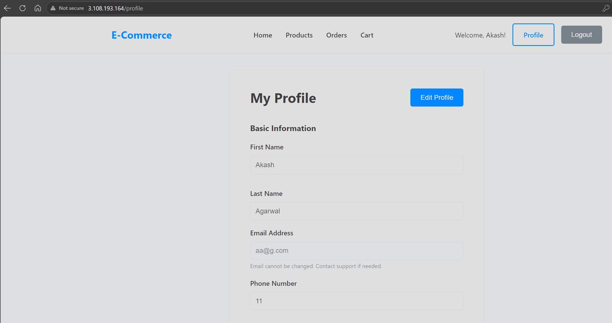

# Testing and Validation

This document records what was tested on the deployed environment, how each check can be repeated and what has not been verified. It separates results that were observed from results that are only inferred or expected, and it does not claim end-to-end functionality that has not been demonstrated.

Related documents: [README](../README.md), [architecture](architecture.md), [deployment guide](deployment-guide.md), [troubleshooting](troubleshooting.md).

## Contents

1. [Purpose and Evidence Conventions](#purpose-and-evidence-conventions)
2. [Validation Layers](#validation-layers)
3. [Results Summary](#results-summary)
4. [Configuration Review Checks](#configuration-review-checks)
5. [Test Procedures](#test-procedures)
6. [Known Limitations](#known-limitations)
7. [Updating This Document](#updating-this-document)

## Purpose and Evidence Conventions

Status values used in the tables:

| Status | Meaning |
| --- | --- |
| PASS | The expected result was observed, or the configuration review confirmed it. |
| PARTIAL | Part of the expected result was observed; the rest is untested or limited by missing data. |
| NOT VERIFIED | Not tested, or the result does not allow a conclusion. This is neither a pass nor a failure. |
| NOT APPLICABLE | The check does not apply, for example a route the service intentionally does not define. |

Sources of evidence:

- **Observed**: results reported by the project author from the deployed AWS environment (`ap-south-1`). No screenshots were present in the repository when this document was written, so the screenshot placeholders below mark what still has to be attached.
- **Inferred**: a conclusion that follows from an observed result together with the source code. These rows say so.
- **Configuration review**: statements made by reading the Terraform, Docker, Nginx and source files. They describe configuration, not runtime behavior.
- **Not run**: procedures that are documented here but have not been executed.

## Validation Layers

A single request can fail or succeed for very different reasons, so the checks are grouped into four layers. A pass at one layer does not prove the layers above it.

| Layer | Question | Typical check | What a pass shows | What it does not show |
| --- | --- | --- | --- | --- |
| Network reachability | Can the frontend instance connect to each backend port? | `nc -zv`, `curl` to `<backend-private-ip>:<port>` | Routing, security groups and a listening process work | That any particular API route exists |
| API route validity | Does a specific endpoint exist and answer correctly? | `curl -i` on a real route such as `/api/products` | The route is implemented and reachable through the proxy | That the database contains data |
| Database content | Does the database hold the records a feature needs? | Product list, user lookup | Data exists for that feature | That other features work |
| End-to-end functionality | Can a user complete a task such as a purchase? | Register, add to cart, check out, pay | The full chain works for that task | Anything outside the task |

An HTTP 404 on a base path such as `/` proves that Express answered (network reachability), but it says nothing about whether the real routes work (API route validity). An empty product list proves the route and database query worked (route validity and database connectivity), but it says nothing about catalog content (database content).

## Results Summary

| Test | Method | Observed result | Status |
| --- | --- | --- | --- |
| Terraform apply | `terraform apply` for `ap-south-1` | Applied successfully (reported by the author) | PASS |
| Frontend container created by user-data | Frontend instance after first boot | Initially the container was not created because the `docker run` command in the user-data was malformed. After the Terraform correction the frontend is served. See the [case study](troubleshooting.md#4-case-study-frontend-container-not-created). | PASS (after the fix) |
| Frontend availability | Browser request to `http://<frontend-public-ip>` | Website accessible on the frontend instance's public IPv4 address | PASS |
| User registration | Register a new account in the browser | Registration worked | PASS |
| User login | Log in with the registered account | Login worked | PASS |
| Network: backend ports from the frontend instance | HTTP requests from the frontend EC2 instance to `<backend-private-ip>` ports 3001, 3002, 3003 and 3004 | Each port returned an Express HTTP response | PASS |
| API route: backend root path | `GET /` on each backend service | HTTP 404 | NOT APPLICABLE (the services define no route at `/`; the response shows that Express answered) |
| API route: `/api/auth/`, `/api/cart/`, `/api/orders/` | `GET` on these base paths | HTTP 404 | NOT VERIFIED (inconclusive: the source defines no handler at these exact paths, so a 404 is expected; real routes such as `/api/cart/<userId>` were not tested) |
| Nginx proxy: product list | `GET /api/products` through Nginx, following redirects | `301` redirect to `/api/products/`, then HTTP 200 | PASS |
| API route: product list response | Same request | `{"products":[],"totalPages":0,"currentPage":1,"total":0}` | PASS (valid response, empty result) |
| Database: product service query | Inferred from the product list response | The handler builds this response only after its `find` and `countDocuments` queries return, which indicates the product service reached MongoDB | PASS (inferred) |
| Database content: product catalog | Product list | No products. The Atlas database is new and the repository contains no seed script. | NOT VERIFIED |
| Database: user service to Atlas | Inferred from registration and login | Registration writes a user and login reads it, which requires a working Atlas connection | PASS (inferred) |
| Secrets Manager: connection string retrieval | Inferred from the row above | The only source of `MONGODB_URI` in the backend user-data is the secret `ecommerce/backend` | PASS (inferred) |
| Secrets Manager: JWT secret delivery | Not testable from the recorded observations | Login works with either the configured secret or the application's built-in default, so it does not show which one is used. See [known limitations](#known-limitations). | NOT VERIFIED |
| Backend `/health` endpoints | `curl` to `<backend-private-ip>:<port>/health` | Not recorded | NOT VERIFIED |
| EC2 status checks | EC2 console or CLI | Not recorded | NOT VERIFIED |
| Browser Network-tab validation | Browser developer tools | Not recorded | NOT VERIFIED |
| Cart operations | Add, update and remove items | Not tested | NOT VERIFIED |
| Order creation and checkout | Place an order from the cart | Not tested | NOT VERIFIED |
| Payment processing (simulated) | Pay for an order | Not tested | NOT VERIFIED |
| End-to-end purchase flow | Register, add to cart, check out, pay | Not tested | NOT VERIFIED |

## Configuration Review Checks

These checks come from reading the files in `terraform/` and describe the intended configuration, not a runtime test. Rules added by hand in the AWS console are not covered.

| Check | Evidence in the configuration | Result |
| --- | --- | --- |
| The backend instance has no public IP | `associate_public_ip_address = false`; the instance is in the private subnet | PASS (configuration) |
| Backend ports accept traffic only from the frontend | Four inbound rules (TCP 3001 to 3004) whose source is the frontend security group | PASS (configuration) |
| The frontend exposes only HTTP | One inbound rule, TCP 80 from `0.0.0.0/0` | PASS (configuration) |
| No SSH rule is defined | No inbound rule for TCP 22 on either security group | PASS (configuration); SSH needs a temporary manual rule |
| Secret values are not stored in the repository | The secret is read through a `data` source (metadata only) and at boot by the instance; no credentials appear in the repository files | PASS (configuration) |
| IAM permissions are minimal | One action (`secretsmanager:GetSecretValue`) on one resource (the secret ARN) | PASS (configuration) |
| Terraform state and key files are not tracked | `.gitignore` lists `*.tfstate`, `.terraform/`, `*.tfvars` and `.env` files; it does not list `*.pem` | PARTIAL (add `*.pem` and keep key files outside the repository) |

## Test Procedures

The [Results Summary](#results-summary) shows which checks were actually run. Unless a result is labeled as observed, the expected results below come from the source code and the configuration and are not recorded outcomes.

Commands that talk to the backend must run on the frontend instance, because only that instance can reach the backend ports. Connect with the steps in the [deployment guide](deployment-guide.md#15-ssh-into-the-frontend-instance). Do not paste secrets, tokens or passwords into screenshots or logs.

### 1. Terraform validation and plan/apply checks

```bash
cd terraform
terraform init
terraform validate
terraform plan -out=tfplan
terraform apply tfplan
terraform plan
```

| Step | Expected result |
| --- | --- |
| `terraform validate` | `Success! The configuration is valid.` |
| First `terraform plan` | `Plan: 17 to add, 0 to change, 0 to destroy.` |
| `terraform apply tfplan` | `Apply complete! Resources: 17 added, 0 changed, 0 destroyed.` followed by the outputs, including `frontend_public_ip` |
| `terraform plan` after the apply | No changes. If it proposes to replace an instance, read the plan carefully before applying (see [troubleshooting](troubleshooting.md#13-terraform-plans-that-replace-ec2-instances)). |

Observed: the apply completed successfully. Screenshots for these steps belong to sections 9 to 11 of the [deployment guide](deployment-guide.md).

### 2. EC2 instance status checks

In the EC2 console, both instances should be `Running` with `2/2 checks passed`. The same check from the CLI (instance IDs from `terraform output -raw frontend_instance_id` and from `aws ec2 describe-instances` filtered on the tag `Name=ecommerce-backend`):

```bash
aws ec2 describe-instance-status --region ap-south-1 --include-all-instances \
  --instance-ids <frontend-instance-id> <backend-instance-id> \
  --query "InstanceStatuses[].[InstanceId,InstanceState.Name,SystemStatus.Status,InstanceStatus.Status]" \
  --output table
```

Expected: state `running`, system status `ok`, instance status `ok`. Status: NOT VERIFIED (not recorded).

### 3. Docker container and image checks

On the frontend instance:

```bash
sudo docker ps -a
sudo docker images
sudo docker logs ecommerce-frontend --tail 100
```

Expected: a container named `ecommerce-frontend` with status `Up` and ports `0.0.0.0:80->80/tcp`, created from `akash0505/ecommerce-frontend:latest`. If the container does not exist, read `/var/log/cloud-init-output.log` (see the [case study](troubleshooting.md#4-case-study-frontend-container-not-created)).

The backend instance cannot be reached over SSH with the current security group rules, so `docker ps` and `docker logs` cannot be run there. The backend containers (`user-service`, `product-service`, `cart-service`, `order-service`) are checked indirectly through their HTTP responses (procedures 4 and 5). The boot output of the backend instance can be read without SSH:

```bash
aws ec2 get-console-output --region ap-south-1 --instance-id <backend-instance-id> --latest --output text
```

### 4. Backend TCP connectivity checks from the frontend instance

```bash
BACKEND=<backend-private-ip>
for p in 3001 3002 3003 3004; do nc -zv -w 3 $BACKEND $p; done
```

If `nc` is not installed, install it with `sudo yum install -y nmap-ncat`, or use Bash directly:

```bash
for p in 3001 3002 3003 3004; do
  timeout 3 bash -c "</dev/tcp/$BACKEND/$p" && echo "port $p open" || echo "port $p closed or filtered"
done
```

How to read the result:

| Result | Meaning |
| --- | --- |
| Connection succeeds | The route, the backend security group and a listening process are all in place. |
| Timeout | A security group, route or wrong IP address is blocking the connection. |
| Connection refused | The network path works, but nothing is listening on that port (the container is not running). |

Observed: HTTP requests from the frontend instance to all four ports returned Express responses, which is a stronger result than an open TCP port. Status: PASS.

### 5. Direct backend API tests

Run on the frontend instance with `BACKEND=<backend-private-ip>`. These calls bypass Nginx and test the services themselves.

```bash
curl -i http://$BACKEND:3001/health
curl -i http://$BACKEND:3002/health
curl -i http://$BACKEND:3003/health
curl -i http://$BACKEND:3004/health

curl -i http://$BACKEND:3002/api/products
curl -i http://$BACKEND:3002/api/categories
curl -i http://$BACKEND:3003/api/cart/<userId>
curl -i http://$BACKEND:3004/api/orders/user/<userId>
```

Expected results, taken from the route files (not yet recorded):

| Request | Expected |
| --- | --- |
| `GET /health` on each service | `200` with JSON naming the service, `"status":"OK"` and the port |
| `GET /api/products` | `200` with `{"products":[...],"totalPages":...,"currentPage":...,"total":...}`; no redirect, because the service handles both `/api/products` and `/api/products/` |
| `GET /api/categories` | `200` with JSON |
| `GET /api/cart/<userId>` | `200` with the user's cart. If the user has no cart, the service creates an empty one, so this request writes to the database. |
| `GET /api/orders/user/<userId>` | `200` with the user's orders (empty for a new user) |

`<userId>` is the `_id` of a registered user. It appears in the registration response and in the browser's local storage under the `user` key.

Observed base-path results: requests to `/`, `/api/auth/`, `/api/cart/` and `/api/orders/` returned `404`. That is expected, because the source defines no route at those exact paths (for example the cart routes all start with `/:userId`). These results show that Express answered, and they say nothing about the real routes.

### 6. Nginx proxy tests

Run from any machine, or from the frontend instance:

```bash
curl -i  http://<frontend-public-ip>/api/products
curl -iL http://<frontend-public-ip>/api/products
curl -i  http://<frontend-public-ip>/api/categories
```

| Request | Result |
| --- | --- |
| `GET /api/products` without `-L` | `301 Moved Permanently` with a `Location` header ending in `/api/products/` (observed) |
| `GET /api/products` with `-L` | The redirect is followed and the final response is `200` with `{"products":[],"totalPages":0,"currentPage":1,"total":0}` (observed) |
| `GET /api/categories` | Expected `200` with JSON and no redirect, because this location has no trailing slash (not yet recorded) |

The 301 comes from Nginx, not from the application (see [architecture.md](architecture.md#5-nginx-reverse-proxy-behavior)). Do not use `/health` on the frontend address as a health check: it is not proxied and returns the React `index.html`.

### 7. Browser Network-tab validation

1. Open `http://<frontend-public-ip>` and open the browser developer tools (F12), then the Network tab. Filter by `Fetch/XHR`.
2. Reload the page and open `/products`, then register or log in.
3. Check each request:
   - The request URL starts with `http://<frontend-public-ip>/api/` and not with `localhost`. A `localhost` address means the frontend image was built without the `/` build arguments.
   - `POST /api/auth/register` returns `201` and `POST /api/auth/login` returns `200` (status codes defined in the user service).
   - The product list request appears twice: the `301` response and the follow-up `200` request to `/api/products/...`.
   - After login, API calls carry an `Authorization: Bearer ...` header. Do not capture its value in a screenshot.
   - Responses are JSON, not HTML. An HTML response to an `/api/...` request means the path did not match an Nginx location.

Status: NOT VERIFIED (procedure documented; results not recorded).

### 8. Registration and login verification

In the browser: open `/register`, create an account with the required fields (first name, last name, email and password; phone is optional), then log out and log in at `/login`. After registration the application logs the user in automatically.

Optional API-level check through the proxy:

```bash
curl -i -X POST http://<frontend-public-ip>/api/auth/register \
  -H "Content-Type: application/json" \
  -d '{"firstName":"Test","lastName":"User","email":"<test-email>","password":"<test-password>"}'

curl -i -X POST http://<frontend-public-ip>/api/auth/login \
  -H "Content-Type: application/json" \
  -d '{"email":"<test-email>","password":"<test-password>"}'
```

Expected from the source: `201` with the message `User registered successfully`, then `200` with `Login successful`. Both responses contain a token and the user without the password. A wrong password returns `400` with `Invalid credentials`.

Observed: registration and the following login worked in the browser. Status: PASS. The result is also evidence that the user service is connected to MongoDB Atlas (see the Results Summary).

>

### 9. Product endpoint response and the empty catalog

Observed response of `GET /api/products` (after the redirect):

```json
{"products":[],"totalPages":0,"currentPage":1,"total":0}
```

What this tells us, by layer:

- **Network reachability and route validity:** the request crossed Nginx, reached the product service and matched a real route. This is a successful response (`200`), not an error.
- **Database connectivity:** the handler returns this body only after `Product.find(...)` and `Product.countDocuments(...)` complete, so the product service reached MongoDB.
- **Database content:** the catalog is empty. The Atlas database is newly configured and the repository contains no seed script, so no products exist yet. An empty list is a valid result, not a fault.
- **End-to-end functionality:** not established. Browsing real products, the cart and ordering all need data.

Optional: add test data (not yet performed). These calls change the database, and the product and category write endpoints have no authentication, so use them only on a test deployment. Use the trailing slash in `/api/products/`: a `POST /api/products` without it is answered with the `301` redirect and the body is not repeated.

```bash
# 1. Create a category and note category._id in the response
curl -i -X POST http://<frontend-public-ip>/api/categories \
  -H "Content-Type: application/json" \
  -d '{"name":"Test Category","description":"Category used for testing","slug":"test-category"}'

# 2. Create a product in that category
curl -i -X POST http://<frontend-public-ip>/api/products/ \
  -H "Content-Type: application/json" \
  -d '{"name":"Test Product","description":"Product used for testing","price":9.99,"brand":"TestBrand","category":"<category-id>","inventory":{"stock":10,"sku":"TEST-SKU-001"}}'

# 3. Confirm the list now contains the product
curl -iL http://<frontend-public-ip>/api/products
```

Expected: `201` for both creations (the models require `name`, `description` and `slug` for a category, and `name`, `description`, `price`, `category`, `brand`, `inventory.stock` and a unique `inventory.sku` for a product), then a list with `"total":1`.

### 10. Cart, order and payment tests (not yet performed)

These checks need at least one product (procedure 9) and a registered user.

1. Log in, open `/products`, add the product to the cart and open `/cart`. This exercises the cart service (`POST /api/cart/<userId>/items`, `GET /api/cart/<userId>`).
2. Start checkout and place the order. The browser sends `POST /api/orders`. According to the code, the order service then reads the cart, validates it, creates the order, reduces product stock and clears the cart, and the checkout page then calls `POST /api/payments/process` (simulated payment).
3. Open `/orders` to see the order.

Read [Known Limitations](#known-limitations) first: two configuration findings may stop step 2 from completing. Record the real outcome of each step in the Results Summary instead of assuming it.

## Known Limitations

Items 1 to 3 were identified by reading the configuration and source. They have not been tested on AWS, so their status is NOT VERIFIED. They are documented, not corrected, and the repository files are unchanged.

### 1. The order service is not given `CART_SERVICE_URL`

- **Evidence:** `backend/order-service/routes/orders.js` reads `CART_SERVICE_URL` (default `http://localhost:3003`) to fetch the cart, validate it and clear it when an order is created. The backend user-data sets only `MONGODB_URI` and `PRODUCT_SERVICE_URL` for the `order-service` container.
- **Expected effect:** inside the order container, `localhost:3003` is the container itself, so the cart lookup fails and `POST /api/orders` would be expected to return `400` with `Cart is empty`. Product browsing, login and cart operations do not depend on this variable.
- **Possible remediation (not applied):** add `-e CART_SERVICE_URL=http://cart-service:3003` to the `order-service` `docker run` command in `terraform/main.tf`, then replace the backend and frontend instances.

### 2. Nginx redirects `POST /api/orders`

- **Evidence:** the frontend sends `POST /api/orders` (`frontend/src/services/api.js`), but the Nginx location is `/api/orders/` with a trailing slash. The author observed the same trailing-slash redirect for `GET /api/products`. A local reproduction made while preparing this documentation (Nginx 1.24 with stub backends and this template) returned `301` with `Location: /api/orders/` for `POST /api/orders`; it was not run on AWS.
- **Expected effect:** browsers repeat a `301`-redirected POST as a GET without the body, and the order service has no `GET /api/orders/` route, so order creation from the browser would be expected to fail. Paths such as `/api/orders/user/<userId>` and `/api/payments/process` are not affected.
- **Possible remediation (not applied):** change the location to `/api/orders` (no trailing slash), as `/api/categories` already is, rebuild the frontend image and redeploy.

### 3. `JWT_SECRET` may not reach the user-service container

- **Evidence:** the user-data script sets `JWT_SECRET` as a plain shell variable and passes it with `-e JWT_SECRET`. That form copies the variable from the environment of the `docker` command, and a shell variable that was not exported is not part of that environment. The user service signs and verifies tokens with `process.env.JWT_SECRET` and falls back to a built-in default string when it is unset.
- **Expected effect:** login and registration still work, which matches the observed results, but tokens would be signed with the built-in default instead of the secret from Secrets Manager.
- **How to check without printing the value** (needs access to the backend instance, which the current rules do not provide): `sudo docker exec user-service sh -c 'test -n "$JWT_SECRET" && echo set || echo unset'`.
- **Possible remediation (not applied):** export the variable in the script (`export JWT_SECRET`) or pass `-e JWT_SECRET="$JWT_SECRET"`, then replace the backend instance.

### 4. Empty catalog and no seed data

The Atlas database is new and the repository has no seed script. Product, cart and order tests need data created first (procedure 9).

### 5. Backend containers cannot be inspected directly

The backend instance has no public IP and no SSH rule, so `docker ps`, `docker logs` and `docker exec` cannot be used on it. Backend health is inferred from HTTP responses and from the boot output (`aws ec2 get-console-output`).

### 6. Frontend build arguments are not recorded in the repository

The Dockerfile accepts four `REACT_APP_*_SERVICE_URL` build arguments, and the values used for the published image are not stored in the repository. The documentation uses `/`, which matches the Nginx proxy design; the observed registration and login, which work through the proxy, are consistent with it.

### 7. `/health` is not proxied

The backend `/health` endpoints can only be called on the backend instance. On the frontend address `/health` returns the React page.

## Updating This Document

After new tests, change the matching row in the [Results Summary](#results-summary), keep the status honest (a test that was not run stays NOT VERIFIED), and replace the screenshot placeholders with images saved in `docs/screenshots/`. If a limitation is corrected in the Terraform or Nginx files, re-run the affected procedure and update or remove its entry above.
